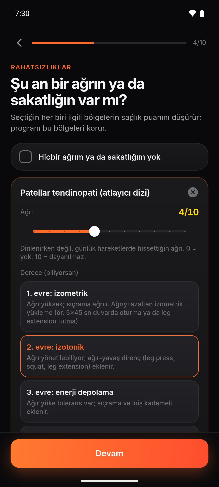
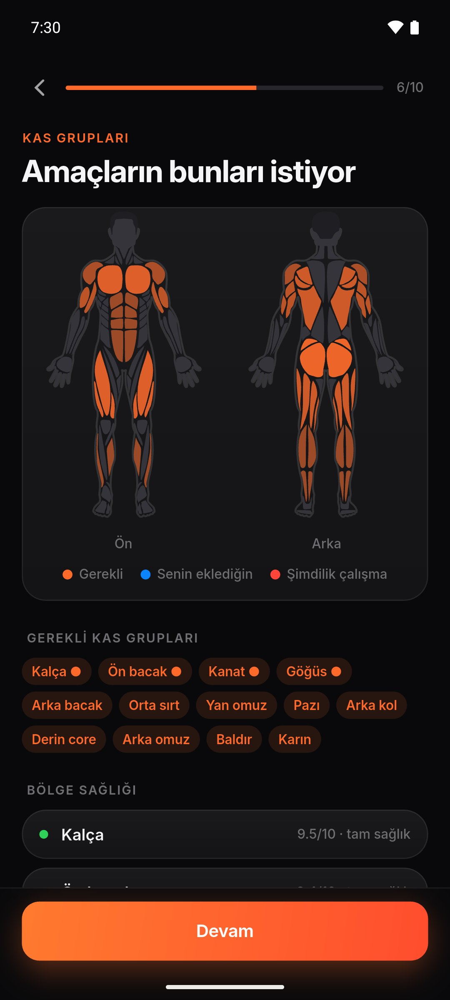
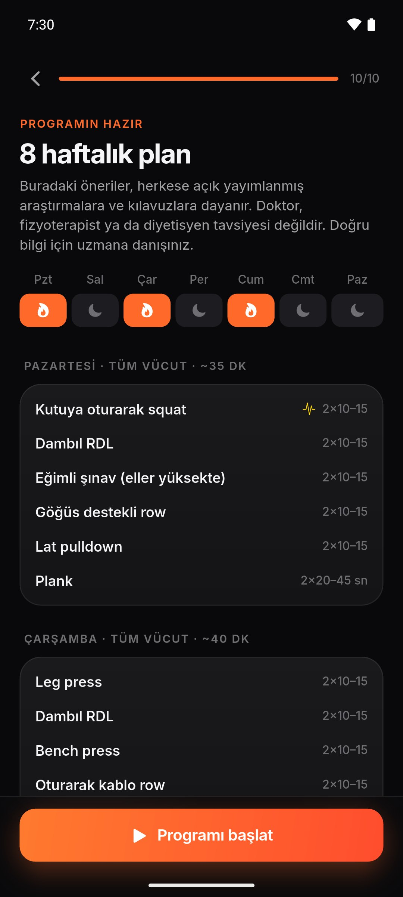
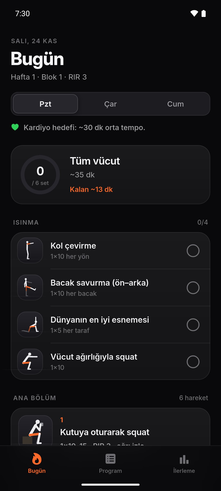

# Saha

**Ağrılarına, amaçlarına ve zamanına göre araştırmalara dayalı bir antrenman programı kuran ve bu programı adım adım yürüten Android uygulaması.**

> **Uyarı:** Buradaki öneriler, herkese açık yayımlanmış araştırmalara ve kılavuzlara dayanır. Doktor, fizyoterapist ya da diyetisyen tavsiyesi değildir. Doğru bilgi için uzmana danışınız.

<p>
  
  
  
  
</p>

## Nasıl çalışır

İlk açılışta kısa bir kurulum akışı vardır:

1. **Uyarı ve onay.** Verilerin yalnız telefonda kalır; hesap da sunucu da yoktur.
2. **Profil:** cinsiyet, yaş ve antrenman geçmişi.
3. **Sağlık taraması:** PAR-Q+ (2023) soruları. "Evet" yanıtı varsa önce doktor onayı istenir.
4. **Rahatsızlıklar:** 41 yaygın ağrı ve sakatlık arasından seçim yapılır.
   - Ağrı için 0–10 arası puan girilir.
   - Burkulma ve yırtılmalarda derece ve ne zaman olduğu girilir.
   - Kırmızı bayrak işaretlenirse program çıkarılmaz ve doktora yönlendirilirsin.
5. **Amaçlar:** birden fazla seçilebilir; örneğin basketbol ve kas kazanma, ya da kilo verme ve genel sağlık.
6. **Kas grupları:** Amaçlarının istediği kaslar vücut haritasında gösterilir. Rahatsızlık yüzünden şimdilik çalışılmaması gereken bölgeler ayrıca belirtilir. İstersen kas grubu ekleyebilirsin; hasarlı bölgeler seçilemez.
7. **Haftalık ihtiyaç:** Kas başına haftalık set ve bundan çıkan gün sayısı gösterilir.
8. **Yer ve günler:** salon, ev ya da dış mekân; evdeysen elindeki ekipman. Kuvvet günlerini ve spor antrenmanı/maç günlerini seçersin.
9. **Süre:** 1 ay (bir blok) ya da 2 ay (iki blok).

Ardından program kurulur. Uygulama program boyunca şunları yapar:

- Seçtiğin günleri aynı kası yükleyen seanslar arasında yeterli toparlanma kalacak şekilde böler (örneğin Cumartesi → Pazartesi 48 saattir). Gerekirse tüm vücut yerine üst/alt bölünmesi kurar.
- Her seansa temel kalıpları koyar: squat, menteşe, itme, çekme ve core. Ağrılı bölgeye uygun olmayan hareketin yerine daha kolay alternatifini koyar.
- Sıçrama çalışmalarını yalnız diz ve ayak bileği sağlıklıysa, en az 48 saat arayla verir.
- Spor gününden önceki seansta bacak yükünü hafifletir.
- WHO önerisine göre haftalık kardiyo hedefini ekler.
- Programı 4 haftalık bloklara böler. Her hafta için RIR ve ilerleme kuralı vardır; seviyene göre deload haftası eklenir ve her blok sonunda test yapılır.

Kuralların hepsi yayımlanmış kılavuz ve araştırmalara dayanır: WHO 2020, ACSM, NSCA ve spor hekimliği dergileri. Bunlara hacim–frekans meta-analizleri, ağrı izleme modeli ve sakatlık iyileşme süreleri de dahildir.

## Özellikler

- **Bugün:** Günün planını gösterir: ısınma, ana bölüm ve soğuma. Kartlarda son kayıt, rekor ve set ilerlemesi görünür. Spor ve kardiyo günleri de belirtilir.
- **267 hareket**, her biri için:
  - **Animasyon:** Kendi çubuk-adam animasyonu hepsinde var. Varsa ExerciseDB'den anatomik animasyon da canlı gelir.
  - **Detay:** zorluk, yaparken dikkat edilecekler ve sık hatalar.
  - **Çalışan bölgeler:** vücut haritası.
  - **Alternatifler:** genel, daha kolay ve daha zor alternatif.
- **Metal tekerlekli kayıt:** Ağırlık ve tekrar fırçalanmış metal görünümlü tekerleklerle seçilir. Her setin mola süresi otomatik sayılır.
- **İlerleme:** Ana kaldırışların rekorları ve grafikleri; vücut ölçümleri.
- **Türkçe ve İngilizce:** Arayüz ve içerik iki dilde.
- **Yedek:** Kayıtlar yalnız telefonda tutulur. Dışa aktarınca panoya kopyalanır; içe aktarma hiçbir şeyi silmez.

## Kurulum

1. [Sürümler](../../releases) sayfasından son `saha-x.y.z.apk` dosyasını telefona indir.
2. Telefonun "bilinmeyen kaynaklardan yükleme" izni sorarsa izin ver ve kur.

Android 7 ve sonrası gerekir. Anatomik animasyonlar için internet bağlantısı gerekir; bağlantı yoksa uygulama kendi çizimini gösterir. Bunun dışında her şey çevrimdışı çalışır.

## Derleme

Gereken araçlar: Flutter 3.44 ve Java 21.

```sh
cd app
flutter test
flutter build apk --release
```

Yayın imzası için `app/android/key.properties` dosyası oluştur. Bu dosya depoya girmez; yoksa APK hata ayıklama anahtarıyla imzalanır.

Kod yapısı (`app/lib/`):

| Dosya | İçerik |
|---|---|
| `motor.dart` | Karar ve program motoru: bölge sağlığı, hareket uygunluğu, haftalık hacim, gün dağıtımı, bloklar |
| `kurulum.dart` | Kurulum akışı |
| `plan_program.dart` | Kurulan planı ekranların program yapısına çevirir |
| `data.dart` | Katalog, program, kayıtlar |
| `wheel.dart`, `figure.dart`, `body_map.dart`, `media.dart` | Tekerlekler, çizim animasyonları, vücut haritası, medya |
| `today.dart`, `exercise_page.dart`, `program_page.dart`, `progress_page.dart` | Ekranlar |

Veri (`app/assets/data/`):

| Dosya | İçerik |
|---|---|
| `motor.json` | Hareketler, rahatsızlıklar, spor/amaçlar, bölgeler, kurallar |
| `katalog.json`, `katalog_ek.json` | Hareket içerikleri |
| `figur.json` | Animasyonlar |
| `en.json` | İngilizce içerik |

## Lisans

Kod ve içerik [MIT](LICENSE) lisanslı. Üçüncü taraf bileşenler ve lisansları [THIRD_PARTY.md](THIRD_PARTY.md) dosyasında:

- Inter yazı tipi (OFL);
- vücut haritası çizimleri (MIT);
- ExerciseDB animasyonları. Bunlar depoda yoktur; uygulama çalışırken canlı olarak alınır.

---

**English:** Saha is an Android app (Flutter) that builds a research-based training program from your pain and injuries, goals, sex, training age, location and available days.

- It screens with PAR-Q+ and red flags.
- It shows needed and to-avoid muscle groups on a body map.
- It spreads sessions over your days with recovery time between them.
- It runs the program in 4-week blocks with RIR targets and deloads.

Every one of its 267 exercises has its own stick-figure animation, plus a live anatomical animation where available. The app is in Turkish and English. Data stays on the device. MIT licensed.

*The suggestions are based on published research and guidelines; they are not advice from a doctor, physiotherapist or dietitian.*
