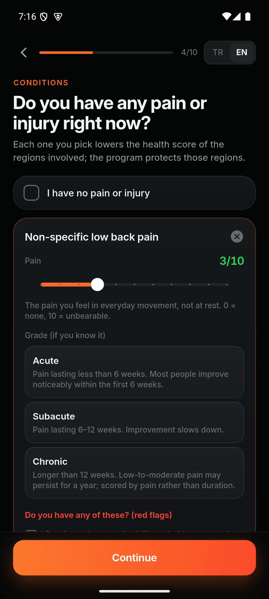
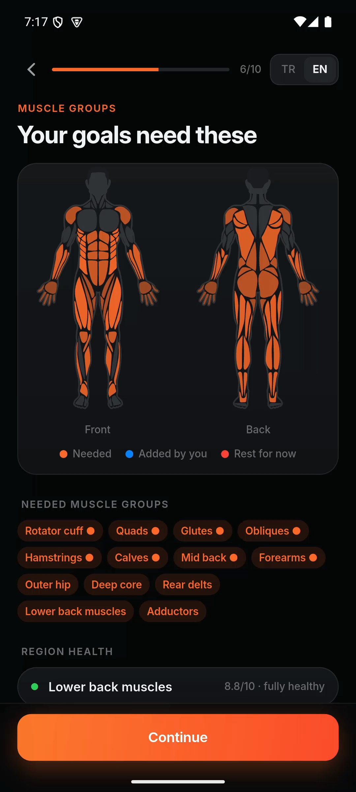
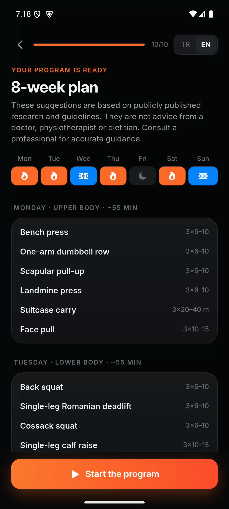
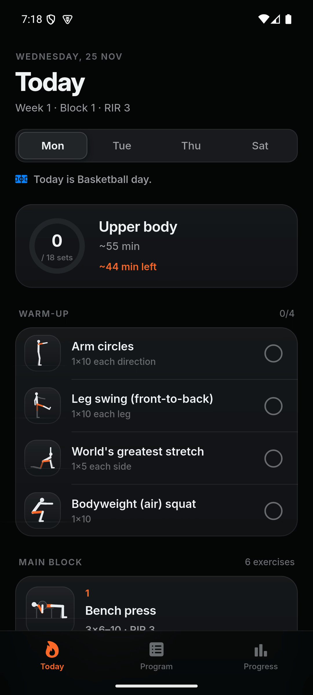
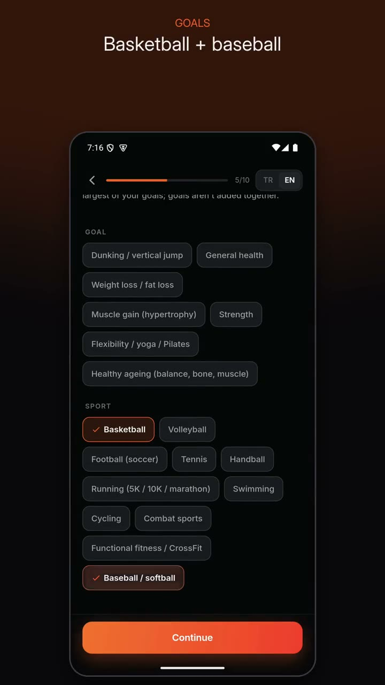
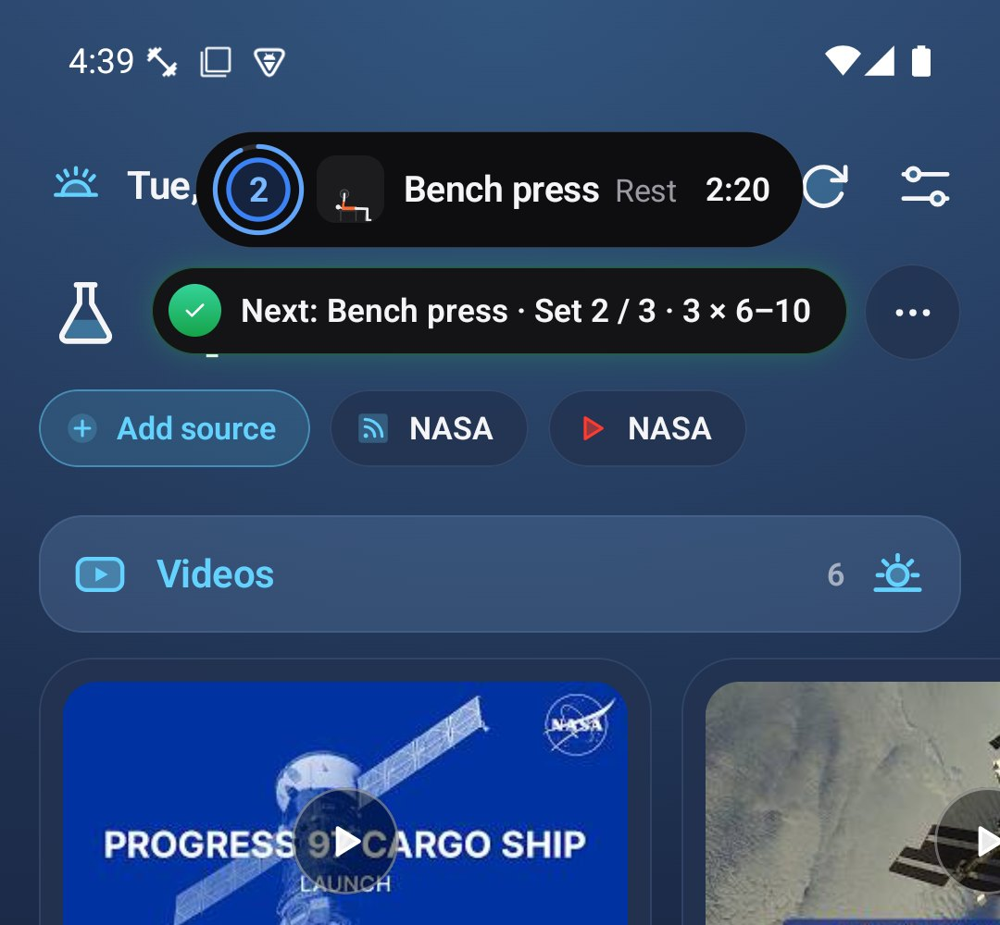
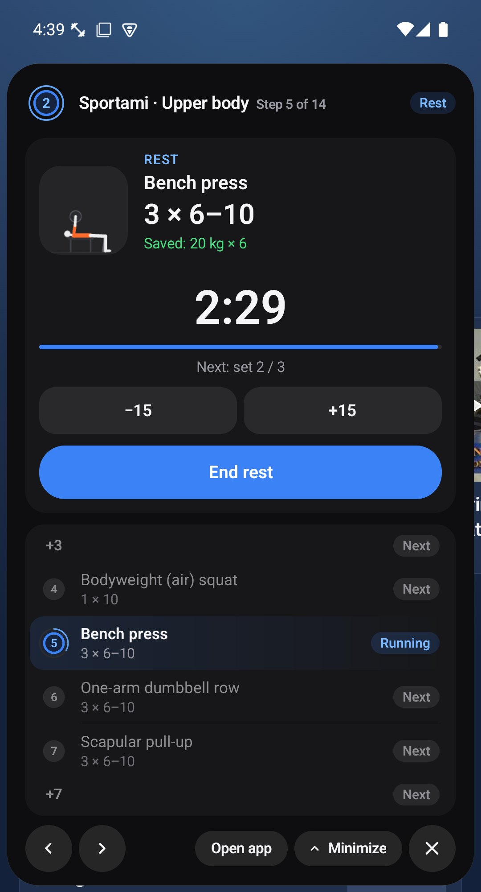
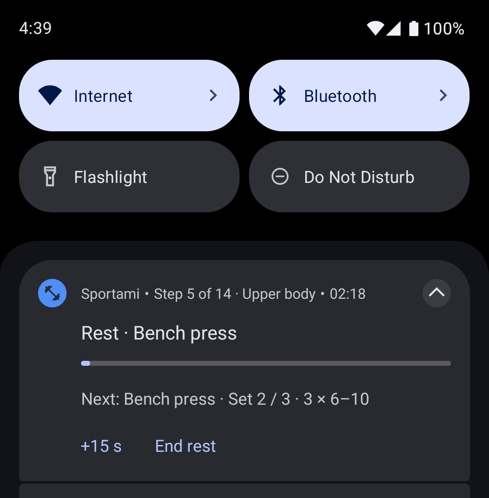

# Sportami

**An Android app that builds a research-based training program around your pain, goals and time, and then walks you through it step by step.**

> **Warning:** The suggestions here are based on publicly published research and guidelines. They are not advice from a doctor, physiotherapist or dietitian. Consult a specialist for accurate information.

<p>
  
  
  
  
</p>

## Promo video

One minute: setup for an intermediate male who plays basketball and baseball, with mild low back pain and 4 gym days a week. The video starts in Turkish and switches the app to English with one tap.

[](media/sportami_promo.mp4)

## Workout island and notification

While you train, Sportami stays with you outside the app, so you can use other apps between sets. The look follows [Agent Presence](https://github.com/DenizTanisman/agent-presence): a circle under the camera, a pill with a capsule, and a card with a task list.

<p>
  
  
  
</p>

**Notification.** During a workout, a notification in the notification shade shows:
- the current exercise and set, with the weight and reps that will be logged;
- during a rest, the countdown;
- the day's exercises as a progress bar;
- a button that logs the set, or during a rest, **+15 s** and **End rest**.

On Android 16 it asks to be a Live Update: it stays pinned at the top of the shade, with a chip in the status bar. It needs no extra permission other than notifications.

**Island** (optional, over other apps):
- **Circle under the camera.** It shows the number of the set to do; the ring around it fills as sets are done.
- **During a rest or a timed set**, the circle becomes a pill with the exercise's animation and the countdown. A capsule under it says what comes next.
- **When the rest is over**, the island turns amber and glows, opens for a few seconds and tells you the next set. The phone vibrates and plays the notification sound.
- **Tap it** to open the card. From the card you can:
  - log the set, after changing kg or reps if needed;
  - start a timed set;
  - shorten or lengthen the rest by 15 seconds, or end it;
  - move to the previous or next exercise.

  The card also lists the day's exercises, each marked **Done**, **Running** or **Next**.

The island hides as soon as you come back to the app. It needs Android's **"Display over other apps"** permission: turn it on in **Progress › Workout island**, or tap **Turn on** on the Today screen, and the app opens the system setting for you.

Both show only during a workout: after you log a set or tap **Go to the island**, and for two hours after your last set. **✕** on the card closes both until your next set.

## How it works

On first launch there is a short setup flow. The app opens in your phone's language (Turkish on a Turkish phone, English otherwise); the TR | EN switch at the top of every setup step, and later in the Progress tab, changes it at once.

1. **Warning and consent.** Your data stays only on your phone; there is no account and no server.
2. **Profile:** sex, age and training history.
3. **Health screening:** the PAR-Q+ (2023) questions. If any answer is "yes", a doctor's clearance is asked for first.
4. **Conditions:** pick from 43 common pains and injuries, including concussion and finger injuries.
   - For pain, you enter a score from 0 to 10. Pain of 3 or less keeps the full program; 4 and above scales the related exercises down. At 8 or above (severe), no program is built until a doctor or physiotherapist has cleared you.
   - For sprains and tears, you enter the grade and when it happened. The penalty fades out over the upper end of the healing time.
   - For concussion, you enter the graded return-to-sport stage (Amsterdam 2022 consensus); each stage leaves out the exercise types it doesn't allow.
   - If a red flag is checked, no program is built and you are referred to a doctor.
5. **Goals:** 18 sports and goals; you can pick more than one, for example basketball and baseball, or weight loss and general health.
6. **Muscle groups:** The muscles your goals need are shown on a body map. Areas you shouldn't train for now because of a condition are marked separately. You can add muscle groups if you like; injured areas can't be selected.
7. **Weekly need:** Weekly sets per muscle and the number of days that follows from them.
8. **Place and days:** gym, home or outdoors; at home, the equipment you have. You choose your strength days and your sport practice/match days.
9. **Duration:** 1 month (one block) or 2 months (two blocks).

Then the program is built. Throughout the program the app:

- Splits your chosen days so there is enough recovery between sessions that load the same muscle (for example, Saturday → Monday is 48 hours). If needed, it sets up an upper/lower split instead of full body.
- Puts the basic patterns into every session: squat, hinge, push, pull and core. An exercise that doesn't suit a painful area is replaced with an easier alternative.
- Gives jump training only if the knees and ankles are healthy, at least 48 hours apart.
- Lightens the leg load in the session before a sport day.
- Adds a weekly cardio target following the WHO recommendation.
- Splits the program into 4-week blocks. Each week has an RIR and a progression rule; a deload week is added according to your level, and each block ends with a test.

All the rules are based on published guidelines and research: WHO 2020, ACSM, NSCA and sports medicine journals. These include volume–frequency meta-analyses, the pain monitoring model and injury healing times.

## Features

- **Today:** Shows the plan for the day: warm-up, main block and cool-down. Cards show the last entry, the record and set progress. Sport and cardio days are marked too.
- **267 exercises**, each with:
  - **Animation:** Every one has its own stick-figure animation. Where available, an anatomical animation is also loaded live from ExerciseDB.
  - **Details:** difficulty, what to watch for while doing it, and common mistakes.
  - **Muscles worked:** a body map.
  - **Alternatives:** a general, an easier and a harder alternative.
- **Metal wheel logging:** Weight and reps are picked with brushed-metal wheels. The rest time of each set is counted automatically.
- **Edit or delete a set:** Press and hold a saved set, then choose **Edit** (the same wheels) or **Delete**. Both can be undone; swipe the undo bar sideways to dismiss it. Set numbers stay in order after a delete.
- **Next exercise:** When all sets of an exercise are done, its page offers the next exercise of the day in one tap; **Extra set** is still there. In a superset it takes you straight to the other half.
- **Workout notification and island** over other apps (see above).
- **Progress:** Records and charts for the main lifts; body measurements.
- **English and Turkish:** The interface and all content (exercises, conditions, sports, program notes) are in both languages. Switch any time; nothing is lost.
- **Backup:** Records are kept only on the phone. Export copies them to the clipboard; import never deletes anything.

## Installation

1. Download the latest `sportami-x.y.z.apk` from the [Releases](https://github.com/DenizTanisman/sportami/releases) page to your phone.
2. If your phone asks for permission to install from unknown sources, allow it and install.

Requires Android 7 or later. Anatomical animations need an internet connection; without one the app shows its own drawing. Everything else works offline.

## Building

Tools needed: Flutter 3.44 and Java 21.

```sh
cd app
flutter test
flutter build apk --release
```

For a release signature, create an `app/android/key.properties` file. This file is not committed to the repo; without it the APK is signed with the debug key.

Code layout (`app/lib/`). The app started as a Turkish project, so file names and some identifiers are Turkish (`motor` = engine, `kurulum` = setup, `kaslar` = muscles); the tables below say what each one holds.

| File | Contents |
|---|---|
| `motor.dart` | Decision and program engine: area health, exercise suitability, weekly volume, day distribution, blocks |
| `kurulum.dart` | Setup flow |
| `plan_program.dart` | Turns the built plan into the program structure used by the screens |
| `data.dart` | Catalog, program, records |
| `wheel.dart`, `figure.dart`, `body_map.dart`, `media.dart` | Wheels, drawn animations, body map, media |
| `today.dart`, `exercise_page.dart`, `program_page.dart`, `progress_page.dart` | Screens |
| `ada.dart` (`ada` = island) | Workout notification and island: what they show and what their buttons do. The Android side is in `android/app/src/main/kotlin/.../`: `Ada.kt` (bridge, service, notification), `AdaGorunum.kt` (the overlay view), `AdaDaire.kt`, `AdaKok.kt`, `AdaRenk.kt` (circle, glow and colors from Agent Presence) |

Data (`app/assets/data/`):

| File | Contents |
|---|---|
| `motor.json` | Exercises, conditions, sports/goals, areas, rules |
| `katalog.json`, `katalog_ek.json` | Exercise content |
| `figur.json` | Animations |
| `en.json` | English content |

## License

Code and content are licensed under [MIT](LICENSE). Third-party components and their licenses are listed in [THIRD_PARTY.md](THIRD_PARTY.md):

- the Inter font (OFL);
- body map drawings (MIT);
- ExerciseDB animations. These are not in the repo; the app fetches them live while it runs.
