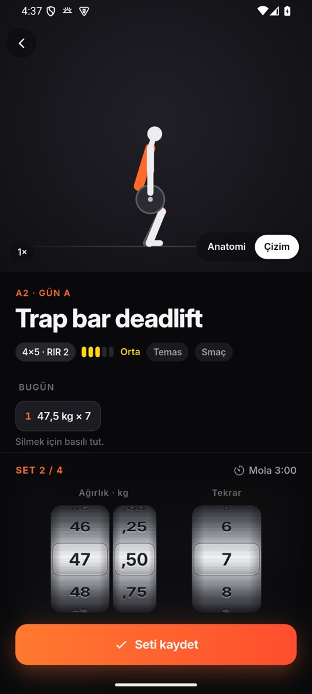
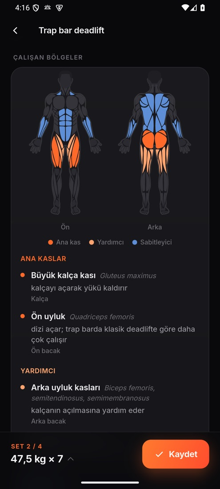
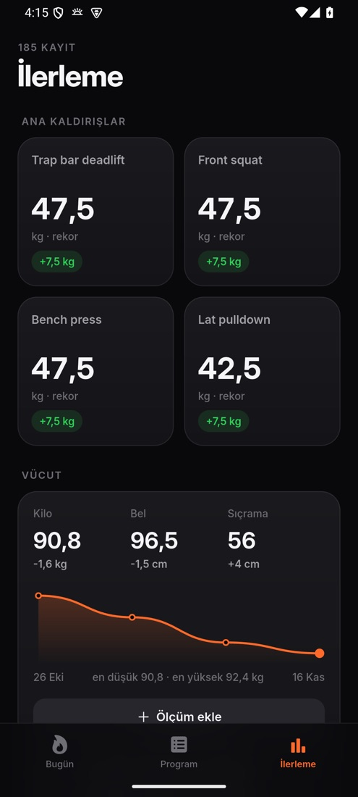
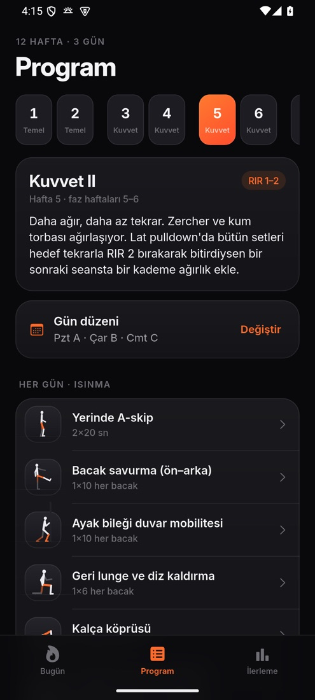
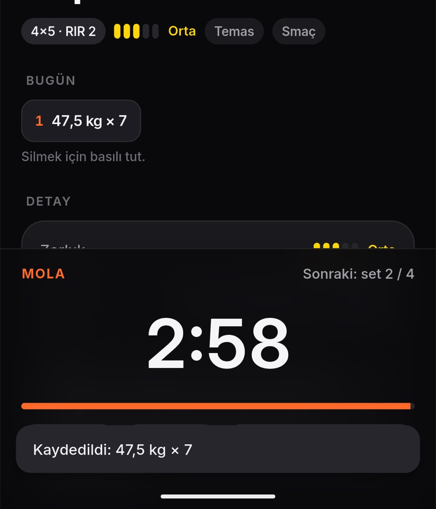
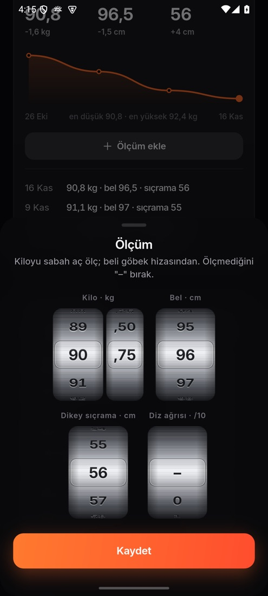

# Saha

**12 haftalık bir kuvvet ve sıçrama programını adım adım yürüten, kayıtlarını tutan Android uygulaması.**

Program haftada 3 gün çalışılır (A, B, C) ve basketbol oynayanlar için tasarlandı: darbeye dayanıklı bir gövde, dizi koruyarak sıçrama ve güçlü bir üst vücut hedefler. Uygulama hangi gün ne yapacağını, hareketi nasıl yapacağını ve hangi kasların çalıştığını gösterir. Her seti metal tekerleklerle kaydedersin, setler arası molayı da kendisi sayar.

<p>
  
  
  
  
</p>

## Özellikler

- **Bugün:** O günün planını gösterir: ısınma, ana bölüm ve soğuma. Süperset olan hareketler birlikte gruplanır. Kartlarda son kaydın, rekorun ve set ilerlemen görünür.
- **12 hafta, 7 faz:** Temel, Kuvvet I-II, hafif hafta, Güç I-II ve zirve. Set ve tekrarlar seçili haftaya göre değişir.
- **Hareket sayfası:**
  - **Animasyon:** varsa anatomik animasyon (ExerciseDB'den canlı gelir), yoksa uygulamanın kendi çizimi.
  - **Detay:** zorluk, amaç, yaparken dikkat edilecekler, sık hatalar ve gerekiyorsa diz için bir not.
  - **Çalışan bölgeler:** ön ve arka vücut haritası. Ana kaslar, yardımcılar ve sabitleyiciler ayrı renkte gösterilir; her kasın hangi bölümünün çalıştığı da yazar.
  - **Alternatifler:** her hareketin genel, daha kolay ve daha zor alternatifi. Birini seçersen o günün planında doğrudan o görünür.
- **Metal tekerlekli kayıt:** Fırçalanmış metal görünümlü tekerleklerle ağırlığı (0,25 kg adımla) ve tekrarı seçersin; her çentikte hafif titreşim olur. Değerler son kaydınla hazır gelir.
- **Mola sayacı:** Her hareketin kendi mola süresi vardır. Süre bitince telefon titrer; mola boyunca ekran açık kalır.
- **İlerleme:** Ana kaldırışların rekorları ve grafikleri. Kilo, bel ve dikey sıçrama ölçümleri de tekerlekle girilir.
- **Gün düzeni:** Varsayılan Pazartesi A, Çarşamba B, Cumartesi C. Program › Gün düzeni'nden değiştirilebilir.
- **Yedek:** Kayıtlar yalnızca telefonda tutulur. Dışa aktarınca bütün kayıtlar panoya kopyalanır. İçe aktarma hiçbir şeyi silmez, yalnızca eksik kayıtları ekler.

<p>
  
  
  
</p>

## Kurulum

1. [Sürümler](../../releases) sayfasından son `saha-x.y.z.apk` dosyasını telefona indir.
2. Telefonun "bilinmeyen kaynaklardan yükleme" izni sorarsa izin ver ve kur.

Android 7 ve sonrası gerekir. Anatomik animasyonlar için internet bağlantısı gerekir; bağlantı yoksa uygulama kendi çizimini gösterir. Bunun dışında her şey çevrimdışı çalışır.

## Derleme

Gereken araçlar: Flutter 3.44 ve Java 21.

```sh
cd app
flutter build apk --release
```

Yayın imzası için `app/android/key.properties` dosyası oluştur. Bu dosya depoya girmez; yoksa APK hata ayıklama anahtarıyla imzalanır.

```properties
storeFile=/yol/release.keystore
storePassword=…
keyAlias=…
keyPassword=…
```

Kod yapısı (`app/lib/`):

| Dosya | İçerik |
|---|---|
| `data.dart` | Katalog, program, kayıtlar |
| `wheel.dart` | Metal tekerlekler |
| `figure.dart` | Çizim animasyonları |
| `body_map.dart` | Vücut haritası |
| `media.dart` | Animasyon ve mola sayacı |
| `today.dart`, `exercise_page.dart`, `program_page.dart`, `progress_page.dart` | Ekranlar |

Hareket içeriği `app/assets/data/katalog.json` dosyasında: 121 hareket, kas listeleri ve alternatifler. Program `program.json` dosyasında.

## Önemli not

Bu uygulama tıbbi tavsiye değildir. Program sağlıklı yetişkinler için yazıldı.

- Dizinde ya da belinde bir sorun varsa, ağır yüklemeye ve sıçrama çalışmalarına başlamadan önce bir spor hekimine danış.
- Yeni hareketleri ilk haftalarda hafif ağırlıkla yap.

## Lisans

Kod ve içerik [MIT](LICENSE) lisanslı. Üçüncü taraf bileşenler ve lisansları [THIRD_PARTY.md](THIRD_PARTY.md) dosyasında:

- Inter yazı tipi (OFL);
- vücut haritası çizimleri (MIT);
- ExerciseDB animasyonları. Bunlar depoda yoktur; uygulama çalışırken canlı olarak alınır.

---

**English:** Saha is an Android app (Flutter) for a 12-week, three-days-a-week strength and jumping programme designed for basketball players. It includes:

- per-exercise pages with anatomical animations, a muscle map and easier/harder alternatives;
- brushed-metal wheel pickers for logging sets;
- rest timers and progress charts.

The interface is in Turkish. Records stay on the device. MIT licensed.
